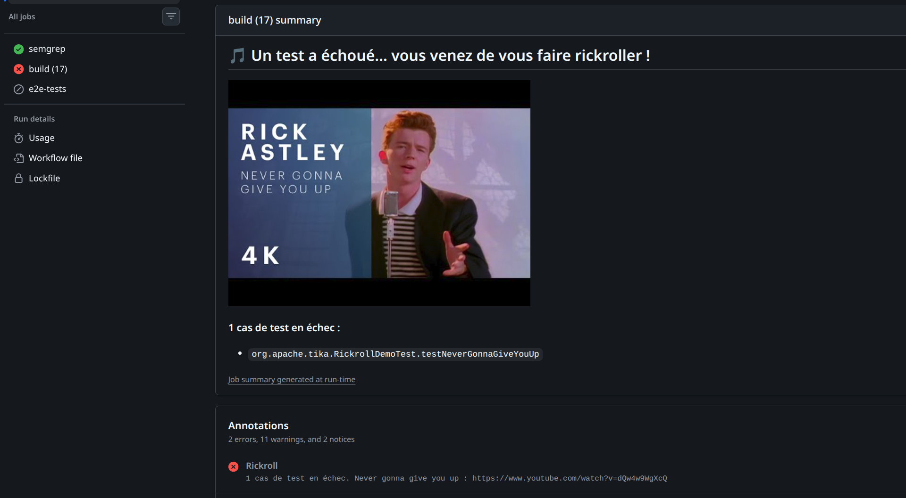

<!--
  Licensed to the Apache Software Foundation (ASF) under one or more
  contributor license agreements.  See the NOTICE file distributed with
  this work for additional information regarding copyright ownership.
  The ASF licenses this file to You under the Apache License, Version 2.0
  (the "License"); you may not use this file except in compliance with
  the License.  You may obtain a copy of the License at

       http://www.apache.org/licenses/LICENSE-2.0

  Unless required by applicable law or agreed to in writing, software
  distributed under the License is distributed on an "AS IS" BASIS,
  WITHOUT WARRANTIES OR CONDITIONS OF ANY KIND, either express or implied.
  See the License for the specific language governing permissions and
  limitations under the License.
-->

# IFT3913 – Tâche 3 : Semgrep, vulnérabilités et rickroll

| Nom | Matricule | GitHub |
|---|---|---|
| Aguibou FOFANA | 20332292 | [@AguibouF](https://github.com/AguibouF) |
| Anas HARTI | 20223975 | [@axh23399](https://github.com/axh23399) |

Cas d'étude : [Apache Tika](https://github.com/apache/tika) (fork [AguibouF/tika](https://github.com/AguibouF/tika)). La tâche 2 est dans le [`README.md` du tag `Tache2VF`](https://github.com/AguibouF/tika/blob/Tache2VF/README.md).

> **Étiquette IAg : Assisté par l'IA** (voir [section 7](#7-utilisation-de-lia)).

1. [Le workflow](#1-le-workflow)
2. [Validation](#2-validation)
3. [Rapport avant](#3-rapport-avant)
4. [Les 7 vulnérabilités](#4-les-7-vulnérabilités)
5. [Avant / après](#5-avant--après)
6. [Rickroll](#6-rickroll)
7. [Utilisation de l'IA](#7-utilisation-de-lia)
8. [Reproduire](#8-reproduire)

## 1. Le workflow

On a modifié le workflow de build de Tika, [`main-jdk17-build.yml`](.github/workflows/main-jdk17-build.yml), en ajoutant un job `semgrep`. Le job `build` en dépend (`needs: semgrep`) : si Semgrep trouve une nouvelle vulnérabilité, le build et les tests e2e ne sont pas lancés et le run est rouge.

```yaml
  semgrep:
    runs-on: ubuntu-latest
    timeout-minutes: 30
    steps:
      - uses: actions/checkout@d23441a48e516b6c34aea4fa41551a30e30af803 # v6
        with:
          fetch-depth: 0
      - name: Install Semgrep
        run: pipx install semgrep==1.185.0
      - name: Semgrep (new findings only)
        env:
          PR_BASE: ${{ github.event.pull_request.base.sha }}
          PUSH_BEFORE: ${{ github.event.before }}
        run: |
          if [ -n "$PR_BASE" ]; then
            BASE=$(git merge-base "$PR_BASE" HEAD)
          else
            BASE="$PUSH_BEFORE"
          fi
          if [ -z "$BASE" ] || ! git cat-file -e "$BASE^{commit}" 2>/dev/null; then
            BASE=$(git merge-base origin/main HEAD)
          fi
          echo "Commit de référence : $BASE"
          semgrep scan --metrics=off \
            --config p/default --config .semgrep \
            --baseline-commit "$BASE" \
            --error --json-output=semgrep.json
      - name: Upload Semgrep report
        if: always()
        uses: actions/upload-artifact@ea165f8d65b6e75b540449e92b4886f43607fa02 # v4
        with:
          name: semgrep-report
          path: semgrep.json
          if-no-files-found: ignore

  build:
    needs: semgrep
```

### Nos choix

- **Seulement les nouvelles vulnérabilités** (`--baseline-commit`). Tika a déjà 84 résultats Semgrep (section 3). Sans référence, le job serait rouge à chaque commit.
- **La référence dépend de l'événement.** Pour un push, c'est le commit d'avant (`github.event.before`). Pour une PR, c'est le point de divergence avec la branche cible : on juge toute la PR, sinon un commit anodin à la fin la ferait passer. Pour une nouvelle branche (`before` = `000…`) ou un push forcé, on retombe sur `git merge-base origin/main HEAD`.
- **`fetch-depth: 0`**, sinon le commit de référence n'est pas dans le clone.
- **`--error`** : sans ça, `semgrep scan` renvoie 0 même s'il trouve quelque chose (testé : 7 résultats, code 0 ; avec `--error`, code 1).
- **Règles** : `p/default` (règles publiques recommandées par Semgrep) et nos 7 règles dans [`.semgrep/`](.semgrep) pour ce que les règles publiques ne voient pas (section 4).
- **Tout le dépôt est scanné.** Avec la référence, Semgrep ne réanalyse que les fichiers modifiés, donc ça reste rapide (moins d'une minute).
- **Versions figées** : Semgrep 1.185.0, et les actions par SHA plutôt que `@v6`. Limite : les règles de `p/default` peuvent quand même évoluer.
- **Rapport JSON gardé** en artefact, même si le job échoue.
- **Pas de compte Semgrep**, donc pas de secret, et n'importe qui peut refaire le scan.
- **Règle de protection sur `main`** : une PR ne peut être fusionnée que si le job `semgrep` est vert. Sans ça, un run rouge signale le problème mais n'empêche pas la fusion.

### Autres changements

- **RAT.** `apache-rat:check` échouait sur 23 fichiers sans licence (archives ChatUniTest de la tâche 2, `rapport_semgrep.txt`). On les a exclus dans [`tika-core/pom.xml`](tika-core/pom.xml) et le [`pom.xml`](pom.xml) racine. Sans ça, un commit propre aurait été rouge pour une autre raison.
- **Module S3 exclu du build.** `S3PipeIntegrationTest` télécharge l'image `quay.io/minio/minio:latest`, qui répond maintenant `401 UNAUTHORIZED`. Le build échouait après 34 min, sans rapport avec notre code ([run 44022015592](https://github.com/AguibouF/tika/actions/runs/44022015592)). On l'exclut avec `-pl '!:tika-pipes-s3-integration-tests'`.
- **Ancienne version.** Notre premier `semgrep.yml` (branche `tache3`) ne pouvait jamais échouer : pas d'`--error`, pas de référence, un seul dossier scanné, pas lié au build. On l'a remplacé.
- **Workflows.** Seul `main jdk17 build` est actif sur le fork. Les autres (Windows, JDK 21/25, Docker, `tache2 tests`) sont désactivés.

## 2. Validation

| # | Commit | Scénario | Résultat |
|---|---|---|---|
| D0 | `39d0eea` | Premier job, actions en `@v6` / `@v4` | ❌ [44017138427](https://github.com/AguibouF/tika/actions/runs/44017138427) |
| V1 | `b18a717` | Actions figées, rien de nouveau | ✅ [44017844653](https://github.com/AguibouF/tika/actions/runs/44017844653) (semgrep OK, build annulé à la main) |
| V2 | 7 commits | Une vulnérabilité par commit, poussée seule | ❌ ×7 (tableau ci-dessous) |
| V3 | `94efed0` | Commit propre alors que des vulnérabilités sont déjà sur `main` | ✅ [44128886839](https://github.com/AguibouF/tika/actions/runs/44128886839) (semgrep, build et e2e OK) |
| V4 | [PR #12](https://github.com/AguibouF/tika/pull/12) | PR `tache3` → `main` avec des vulnérabilités | ❌ [44027966987](https://github.com/AguibouF/tika/actions/runs/44027966987), PR fermée sans fusion |
| V5 | `4cdb284` | Retrait de code vulnérable | ✅ [44131965178](https://github.com/AguibouF/tika/actions/runs/44131965178) (semgrep OK) |

Les 7 vulnérabilités de la section 4, chacune dans son commit et son push :

| Vuln. | Commit | Fichier modifié | Run | Résultats |
|---|---|---|---|---|
| 1 | `25c5272` | `JDBCTableReader` | [44134497734](https://github.com/AguibouF/tika/actions/runs/44134497734) | 2 |
| 2 | `c7f413f` | `Metadata` | [44134686734](https://github.com/AguibouF/tika/actions/runs/44134686734) | 2 |
| 3 | `b358d8b` | `HttpClientFactory` | [44135040648](https://github.com/AguibouF/tika/actions/runs/44135040648) | 4 |
| 4 | `3a75fb7` | `TemporaryResources` | [44135201274](https://github.com/AguibouF/tika/actions/runs/44135201274) | 1 |
| 5 | `bc55fcc` | `CryptoParser` | [44135373420](https://github.com/AguibouF/tika/actions/runs/44135373420) | 2 |
| 6 | `ca55083` | `XMLReaderUtils` | [44135533161](https://github.com/AguibouF/tika/actions/runs/44135533161) | 1 |
| 7 | `ef53eee` | `ProcessUtils` | [44135696762](https://github.com/AguibouF/tika/actions/runs/44135696762) | 1 |

Ce qu'on en retient :

- **D0** est une vraie détection qu'on n'avait pas prévue. Notre premier job utilisait des actions en `@v6` et `@v4`, et la règle `github-actions-mutable-action-tag` l'a bloqué. Le log ne montre que ces **2** résultats, aucun des 84 déjà présents : la référence marche.
- **V2** : chaque run ne signale que le fichier de son commit, car les vulnérabilités précédentes font déjà partie de la référence (le log affiche la référence, par exemple `c7f413f` pour la vulnérabilité 3).
- **V3** : du code vulnérable est déjà sur `main`, et pourtant le commit suivant passe jusqu'au bout. Une vulnérabilité déjà là ne bloque pas les commits suivants.
- **V4** : pour une PR, la référence est le point de divergence avec `main`, donc la PR est jugée sur tout ce qu'elle apporte.
- **V5** : supprimer du code vulnérable n'est pas bloqué.

**Historique.** Notre première version mettait les vulnérabilités dans 7 classes nouvelles, jamais appelées par Tika (runs [1](https://github.com/AguibouF/tika/actions/runs/44028199777), [2](https://github.com/AguibouF/tika/actions/runs/44028624086), [3](https://github.com/AguibouF/tika/actions/runs/44028822958), [4](https://github.com/AguibouF/tika/actions/runs/44029079186), [5](https://github.com/AguibouF/tika/actions/runs/44029247814), [6](https://github.com/AguibouF/tika/actions/runs/44029422354), [7](https://github.com/AguibouF/tika/actions/runs/44029594483), tous ❌ avec une seule nouveauté). On les a retirées (V5) et remplacées par des modifications de fichiers existants (section 4). Ces 7 commits ont d'abord été poussés ensemble : un seul run ([44132985657](https://github.com/AguibouF/tika/actions/runs/44132985657), 13 résultats) les a détectés en bloc. On a alors ramené `main` au commit de retrait et repoussé les 7 commits un par un, pour avoir un run par vulnérabilité (tableau ci-dessus).

### Cas testés hors CI : nouvelle branche et push forcé

Le workflow ne tourne que sur `main` et les PR vers `main`, donc le repli (nouvelle branche, push forcé) ne s'est jamais produit en CI. On l'a testé en local : on a extrait du workflow le script exact de l'étape « Semgrep (new findings only) », puis on l'a lancé dans un dépôt Git jetable avec un faux `origin`, en lui donnant les valeurs que GitHub mettrait dans `PUSH_BEFORE` et `PR_BASE`. La vulnérabilité utilisée est l'injection SQL de notre première version (`InsecureSqlQuery`), avec nos règles `.semgrep/`.

| Scénario | `PUSH_BEFORE` / `PR_BASE` | Référence choisie | Nouveaux résultats | Code |
|---|---|---|---|---|
| Push sur `main`, commit propre | commit précédent | commit précédent | 0 | 0 ✅ |
| Nouvelle branche, commit propre | `000…` | `origin/main` (repli) | 0 | 0 ✅ |
| Nouvelle branche avec la vulnérabilité | `000…` | `origin/main` (repli) | 1 | 1 ❌ |
| Push forcé (ancien commit disparu) | SHA inexistant | `origin/main` (repli) | 1 | 1 ❌ |
| PR avec la vulnérabilité | base = `main` | `merge-base` = `main` | 1 | 1 ❌ |
| Push d'un commit anodin juste après la vulnérabilité | commit de la vulnérabilité | commit précédent | 0 | 0 ✅ |
| Même état, mais en PR | base = `main` | `merge-base` = `main` | 1 | 1 ❌ |

Les deux dernières lignes montrent la différence voulue entre push et PR : sur un push, une vulnérabilité déjà poussée ne bloque plus le commit suivant ; dans une PR, elle bloque tant qu'elle fait partie de ce que la PR apporte.

## 3. Rapport avant

Commit `b18a717`, sans code vulnérable, avec `semgrep scan --metrics=off --config p/default --config .semgrep`. Résultat : **84 résultats**, aucun venant de nos règles ([`semgrep-avant.json`](semgrep-avant.json)).

| Règle | Nb | Exemples |
|---|---|---|
| `github-actions-mutable-action-tag` | 22 | workflows de Tika |
| `unsafe-reflection` | 17 | `ServiceLoader`, `ConfigLoader` |
| `command-injection-process-builder` | 16 | `ExternalParser`, `TesseractOCRParser` |
| `unencrypted-socket` | 4 | `NetworkParser`, `PipesServer` |
| `jdbc-sqli`, `formatted-sql-string` | 3 + 2 | `JDBCTableReader`, `H2Util` |
| règles docker-compose | 6 | `docker-compose-*.yml` |
| autres (XXE, AES/ECB, SHA-1, etc.) | 14 | |

La plupart sont des usages normaux pour Tika (lancer Tesseract avec `ProcessBuilder`, par exemple). C'est pour ça qu'on ne bloque que ce qui est nouveau.

## 4. Les 7 vulnérabilités

**Fichiers.** Chaque vulnérabilité modifie un fichier existant de Tika, là où ce genre de code a sa place : la lecture de bases de données, la sérialisation des métadonnées, le client HTTPS, les fichiers temporaires, le déchiffrement, les parseurs XML et le lancement de programmes externes. Trois d'entre elles changent le comportement de Tika (3, 4, 5) ; les autres ajoutent une méthode publique à côté de ses équivalents sûrs. Tout compile et passe Checkstyle, forbiddenapis et RAT, et les 773 tests de `tika-core`, ceux de `tika-pipes-http` et du parseur SQLite passent encore.

**Règles.** Les 7 sont détectées par des règles publiques de `p/default`. Nos règles `.semgrep/` en signalent aussi 4 (SQL, désérialisation, TLS, MD5). Les règles mot de passe en dur et traversée de chemin viennent de notre première version ; aucun ensemble public ne couvrait ces deux types, c'est pour ça qu'on les a remplacés par XXE et injection de commande.

| # | Type (CWE) | Fichier modifié | Ce qu'on a changé et pourquoi c'est vulnérable | Règles publiques |
|---|---|---|---|---|
| 1 | Injection SQL (89) | [`JDBCTableReader`](tika-parsers/tika-parsers-standard/tika-parsers-standard-modules/tika-parser-jdbc-commons/src/main/java/org/apache/tika/parser/jdbc/JDBCTableReader.java) (lecteur de tables SQL) | Nouvelle méthode `countRowsWhere(column, value)` qui concatène la valeur dans la requête. Avec `x' OR '1'='1`, la condition est toujours vraie. Il faut un `PreparedStatement`. | `formatted-sql-string` |
| 2 | Désérialisation (502) | [`Metadata`](tika-core/src/main/java/org/apache/tika/metadata/Metadata.java) (classe `Serializable`) | Nouvelle méthode `fromSerializedBytes` qui fait `readObject()` sur des octets reçus. Une chaîne de « gadgets » peut exécuter du code. Il faudrait un `ObjectInputFilter`. | `object-deserialization` |
| 3 | TLS non vérifié (295) | [`HttpClientFactory`](tika-pipes/tika-httpclient-commons/src/main/java/org/apache/tika/client/HttpClientFactory.java) (client HTTPS des pipes) | Quand `verifySsl` est **vrai**, le vérificateur par défaut est remplacé par un `HostnameVerifier` qui renvoie toujours `true`. La vérification est désactivée alors que l'utilisateur l'a demandée : attaque de l'homme du milieu possible. | `insecure-hostname-verifier`, `bypass-tls-verification`, `disallow-old-tls-versions1` |
| 4 | Aléatoire faible (330) | [`TemporaryResources`](tika-core/src/main/java/org/apache/tika/io/TemporaryResources.java) (tous les fichiers temporaires de Tika) | `Files.createTempFile` est remplacé par un nom tiré de `new Random().nextLong()`. Le nom est prévisible : dans `/tmp`, un attaquant peut créer le fichier ou un lien symbolique avant Tika. | `weak-random` |
| 5 | Hachage faible (328) | [`CryptoParser`](tika-core/src/main/java/org/apache/tika/parser/CryptoParser.java) (déchiffrement) | Sans clé fournie, la clé AES est dérivée du mot de passe par un seul MD5, sans sel ni itérations, donc cassable par force brute. Il faudrait PBKDF2 avec un sel. | `use-of-md5` |
| 6 | XXE (611) | [`XMLReaderUtils`](tika-core/src/main/java/org/apache/tika/utils/XMLReaderUtils.java) (durcissement des parseurs XML) | Nouvelle méthode `getDocumentBuilderWithoutProtection` dont la fabrique garde les DTD et entités externes. `<!ENTITY x SYSTEM "file:///etc/passwd">` fait lire un fichier local. | `documentbuilderfactory-disallow-doctype-decl-missing` |
| 7 | Injection de commande (78) | [`ProcessUtils`](tika-core/src/main/java/org/apache/tika/utils/ProcessUtils.java) (lancement de programmes externes) | Nouvelle méthode `startShellCommand(program, argument)` qui passe par `sh -c` et concatène l'argument. Un nom de fichier comme `a.pdf; rm -rf ~` lance une seconde commande. | `command-injection-process-builder` |

Les runs de chaque commit sont dans la section 2.

## 5. Avant / après

| | Avant (`b18a717`) | Après (`ef53eee`) |
|---|---|---|
| Fichiers analysés | 2190 | 2194 |
| Résultats | 84 | **96** |
| dont nos règles | 0 | 4 |
| Rapport | [`semgrep-avant.json`](semgrep-avant.json) | [`semgrep-apres.json`](semgrep-apres.json) |

Pour isoler ce qui est nouveau, on a relancé le scan avec `b18a717` comme référence :

```bash
semgrep scan --metrics=off --config p/default --config .semgrep --baseline-commit b18a7174c657f9a1971c4129a92cb7545df9c901
```

```
Current version has 24 findings.
...
• Findings: 13 (13 blocking)
• Scan was limited to files changed since baseline commit.
Ran 451 rules on 17 files: 13 findings.
```

Il y a **13 nouveaux résultats, tous dans les 7 fichiers modifiés** (2 + 2 + 4 + 1 + 2 + 1 + 1), et rien dans le workflow, l'action rickroll ou la documentation. Le total passe de 84 à 96 et non 97 : dans `HttpClientFactory`, la ligne d'origine `new SSLConnectionSocketFactory(sslContext, getDefaultHostnameVerifier())` avait un résultat `disallow-old-tls-versions1`. On l'a remplacée par la version vulnérable, donc l'ancien résultat disparaît et un nouveau apparaît (84 − 1 + 13 = 96).

## 6. Rickroll

On a écrit notre propre action composite, [`.github/actions/rickroll`](.github/actions/rickroll) ([`action.yml`](.github/actions/rickroll/action.yml), [`rickroll.py`](.github/actions/rickroll/rickroll.py)). Elle lit les rapports JUnit de Maven. Si un test a échoué, elle écrit dans le résumé du run une vignette vers *Never Gonna Give You Up* et la liste des tests en échec, plus une annotation. Sinon, elle ne fait rien. Elle est appelée après l'étape Maven des jobs `build` et `e2e-tests` :

```yaml
      - name: Rickroll on test failure
        if: failure() && steps.build.outcome == 'failure'
        uses: ./.github/actions/rickroll
```

- **Pourquoi pas `random-rickroll`** : elle tourne sous Node 12, que GitHub n'exécute plus, et elle réagit à l'ouverture d'une issue, pas à un test qui échoue.
- **Double condition** : le `if` vérifie que Maven a échoué, puis l'action vérifie qu'un cas de test a échoué. Une erreur de compilation ou de RAT ne rickrolle donc pas.
- **Pas de module `xml` en Python** : Semgrep le signale (`use-defused-xml`), ce qui aurait bloqué notre propre commit. On lit les rapports avec des expressions régulières.

| # | Commit | Scénario | Résultat |
|---|---|---|---|
| R1 | `e23e550` | Ajout de l'action | ❌ [44023203879](https://github.com/AguibouF/tika/actions/runs/44023203879) : `S3PipeIntegrationTest` échoue, rickroll déclenché |
| R2 | `e3d7529` | `RickrollDemoTest` avec `assertEquals(1, 2)` | ❌ [44025017417](https://github.com/AguibouF/tika/actions/runs/44025017417) : rickroll avec `RickrollDemoTest.testNeverGonnaGiveYouUp` |
| R3 | `9361ba6` | Retrait du test | ❌ [44026142450](https://github.com/AguibouF/tika/actions/runs/44026142450) : encore S3, rickroll déclenché |
| R4 | `38228fe` | S3 exclu, tout passe | ✅ [44030898014](https://github.com/AguibouF/tika/actions/runs/44030898014) : étape rickroll ignorée |
| R5 | `e04a3f3` | Échec de RAT (pas un test) | ❌ [44119838437](https://github.com/AguibouF/tika/actions/runs/44119838437) : l'étape rickroll tourne mais écrit « Aucun cas de test en échec : pas de rickroll » |

R1 et R3 n'étaient pas prévus, mais ils montrent qu'un vrai test de Tika qui échoue déclenche aussi le rickroll. R4 montre qu'un run vert ne rickrolle pas. R5 montre la double condition en CI : le build a échoué sur RAT (`readmeTache2/README.md` sans licence, corrigé ensuite), aucun test n'a échoué, donc pas de rickroll.

Dans R1 et R3, le test S3 a planté à l'initialisation : le rapport JUnit n'a pas de nom de méthode, et l'action affichait `S3PipeIntegrationTest.`. On l'a corrigé : ce cas s'affiche maintenant `S3PipeIntegrationTest (initialisation)`.

Le résumé du run R2 :



## 7. Utilisation de l'IA

On a utilisé Claude (Anthropic) pour concevoir le job Semgrep, les exclusions RAT, l'exclusion du module S3, la généralisation des règles TLS et jeton, l'insertion des vulnérabilités dans des fichiers existants de Tika, l'action rickroll et les tests hors CI du repli, et pour rédiger ce document. Tous les chiffres et les liens viennent de vraies exécutions de Semgrep, de Maven et de GitHub Actions.

## 8. Reproduire

Depuis la racine du dépôt, avec `pipx install semgrep==1.185.0` :

```bash
# rapport complet
semgrep scan --metrics=off --config p/default --config .semgrep --json-output=semgrep-apres.json

# seulement ce qui est nouveau depuis b18a717
semgrep scan --metrics=off --config p/default --config .semgrep --baseline-commit b18a7174c657f9a1971c4129a92cb7545df9c901
```

Pour le rapport avant, on se place sur `b18a717` et on relance la première commande.
